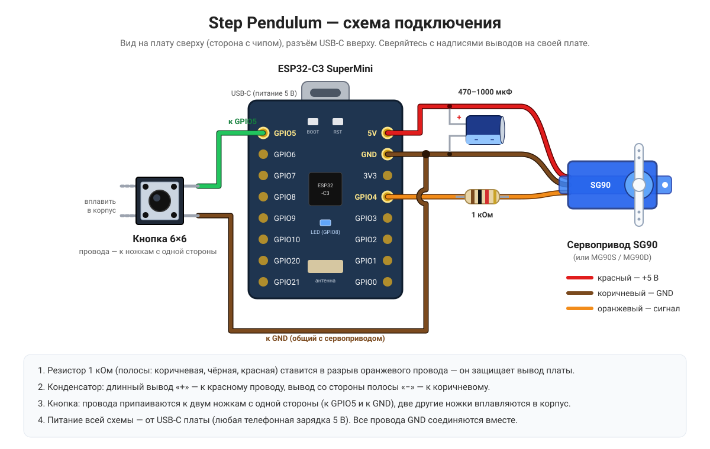

# Step Pendulum — маятник для шагов

Настольное устройство, которое качает телефон как маятник. Аппаратный шагомер телефона воспринимает
эти колебания как ходьбу, и шаги появляются в Google Fit, Health Connect и других приложениях
как обычные шаги с датчика телефона.

## Идея проекта: максимально просто и дешево

Цель — устройство, которое может повторить любой, с себестоимостью около **$5**. Поэтому:

- **Сервопривод — самый доступный SG90** (дешевле $1).
- **Кнопка без платы** — обычная тактовая кнопка 6×6, её можно выпаять из любой ненужной техники.
- **Рука маятника не печатается** — используется готовая линейка (деревянная или пластиковая).
- **Пружинки подойдут от старых шариковых ручек.**
- **Корпус и кроватка для телефона печатаются на 3D-принтере** без поддержек.
- **Прошивка на [ESPHome](https://esphome.io)** — можно прошить готовый файл прямо из браузера.

| Струбцина с сервоприводом и платой | Кроватка для телефона |
|---|---|
|  |  |

## Как это работает

Струбцина крепится на край стола. В ней вертикально стоит сервопривод, на ступицу его качалки
надета линейка — рука маятника. На линейке закреплена кроватка с телефоном.
Маятник качается на ступице свободно, а сервопривод раскачивает его через **две пружинки**,
идущие от концов качалки к линейке. Когда частота привода совпадает с собственной частотой маятника
(резонанс), сервоприводу хватает небольшого движения, а маятник раскачивается широко.

**Почему частота 0,9 Гц.** Обычный темп ходьбы — около 1,8 шага в секунду. В качающемся телефоне
акселерометр видит пик ускорения в нижней точке — **дважды за один период качания**.
Поэтому маятник качается с частотой 0,9 Гц, и каждый период засчитывается как 2 шага.

**Почему нужен широкий размах.** При малом отклонении сигнал для шагомера слишком слабый,
уверенный счёт начинается примерно с ±25–35°. А шагомеры начинают считать только после серии
из 7–10 «шагов» подряд, поэтому устройство всегда работает непрерывной серией с плавным разгоном
и затуханием.

## Детали

| Деталь | Кол-во | Примечание |
|---|---|---|
| ESP32-C3 SuperMini | 1 | контроллер, питание и прошивка через USB-C |
| Сервопривод SG90 | 1 | дешевле $1; MG90S или MG90D прослужат дольше |
| Тактовая кнопка 6×6 мм | 1 | можно выпаять из старой техники |
| Резистор 1 кОм | 1 | в сигнальный провод сервопривода |
| Конденсатор электролитический 470–1000 мкФ, от 6,3 В | 1 | обычный, с выводами с одной стороны |
| Пружинки | 2 | подойдут от шариковых ручек |
| Винт M3 с гайкой | 1 | якорь пружинок на линейке |
| Линейка шириной 30 мм, толщиной до 5 мм | 1 | деревянная или пластиковая; у пластика ниже трение на оси |
| Резиновая накладка | 1 | на пятку струбцины, чтобы не портить стол |
| Тонкий провод (МГТФ, 30 AWG) | — | от кнопки к плате |
| Кабель USB-C и блок питания 5 В | 1 | любой телефонный |

## Схема подключения



| ESP32-C3 SuperMini | Куда |
|---|---|
| 5V | красный провод сервопривода |
| GND | коричневый провод сервопривода и кнопка |
| GPIO4 | оранжевый провод сервопривода **через резистор 1 кОм** |
| GPIO5 | кнопка |
| GPIO8 | встроенный светодиод платы, ничего подключать не нужно |

- **Резистор 1 кОм** защищает вывод платы: если сервопривод выйдет из строя, на сигнальный провод
  может попасть 5 В.
- **Конденсатор** сглаживает броски тока при движении сервопривода. Длинный вывод («+») — к красному
  проводу, вывод со стороны полосы («−») — к коричневому.
- **Кнопка:** провода припаиваются к **двум ножкам с одной стороны** (одна к GPIO5, другая к GND),
  две ножки с другой стороны вплавляются в корпус. Внешний резистор кнопке не нужен.
- ESPHome при сборке предупреждает, что GPIO8 — strapping-пин. Для светодиода это нормально.

Распиновка платы: [Schematic/esp32-c3-super-mini-pinouts.jpg](Schematic/esp32-c3-super-mini-pinouts.jpg)

## 3D-печать

Модели сделаны в OpenSCAD и параметрические: размеры меняются под свою столешницу и телефон.

- **Пластик:** PLA или PETG — оба подходят.
- **Настройки:** 4–5 периметров, заполнение 20%, слой 0,16–0,2 мм. **Поддержки не нужны.**
- **Расход:** около **145 г** пластика, это примерно **48 м** филамента 1,75 мм
  (при цене $15–20 за килограмм — $2–3).

| Деталь | Файл | Как печатать | PLA, г | Филамент, м |
|---|---|---|---|---|
| Корпус струбцины | `3D/Clamp/body_v4.stl` | на боку, ориентация уже задана в STL | 60 | 20 |
| Прижимной винт | `3D/Clamp/screw.stl` | барашком вниз | 13 | 4,5 |
| Пятка винта | `3D/Clamp/pad.stl` | контактной стороной вниз | 3,5 | 1,2 |
| Кроватка | `3D/Cradle/cradle.stl` | стоя на нижнем ребре | 63 | 21 |
| Болт кроватки | `3D/Cradle/bolt.stl` | | 1 | 0,4 |
| Гайка-барашек | `3D/Cradle/knob.stl` | | 5 | 1,6 |
| **Итого** | | | **≈145** | **≈48** |

Расход посчитан по объёму моделей; в вашем слайсере цифры будут немного другими.

### Струбцина

- Ширина 30 мм, подходит для столешниц толщиной **до 50 мм**.
- **Резьба Ø15 (шаг 4 мм) печатается прямо в нижней губке**, отдельная гайка не нужна.
  Если винт идёт слишком туго или болтается, измените зазор `cs_clr` в исходнике.
- На конце винта шар Ø10. Пятка защёлкивается на шар и поворачивается по поверхности стола.
  Сверху на пятку наклейте резиновую накладку.
- **Сервопривод стоит вертикально** и вставляется изнутри, со стороны стола; вал смотрит наружу.
  Ушки прикручиваются комплектными шурупами изнутри, концы шурупов спрятаны в приливы на наружной стенке.
- **Плата ESP32-C3 SuperMini лежит открыто на верхней грани** и защёлкивается между рёбрами.
  Разъём USB-C смотрит в торец, под штекер сделана выемка.
- **Кнопка** утоплена в верхнюю губку, от неё к плате идёт скрытый канал для провода.

### Кроватка для телефона

- Телефон до **165×80×14 мм** лежит **горизонтально** и вставляется сверху.
- Нижней стенки нет: телефон держат угловые захваты.
- Сзади направляющие под линейку шириной 30 мм. Они ниже толщины линейки, поэтому барашек
  прижимает именно линейку.

### Свои размеры

Откройте `.scad` в OpenSCAD, поменяйте параметры в начале файла (например `phone_l`, `phone_w`,
`phone_t` для телефона, `ruler_w`, `ruler_t` для линейки или `table_max` для столешницы),
выберите деталь в переменной `part` и экспортируйте STL (F6, затем Export as STL).

## Сборка

1. **Линейка.** Просверлите у одного конца отверстие **Ø6 мм** — оно надевается прямо на ступицу
   качалки сервопривода, подшипник не нужен. Ниже по линейке просверлите **несколько отверстий
   под болт кроватки** (Ø8,5 мм через 2–3 см) — по ним подбирается длина маятника.
2. **Пружинки.** Примерно в 30 мм ниже оси вкрутите в линейку винт M3. Натяните две пружинки от концов
   качалки к винту так, чтобы они были слегка растянуты и не провисали при качании.
3. **Кнопка.** Припаяйте провода к двум ножкам с одной стороны, протяните их через канал и посадите
   кнопку в углубление. Две ножки с другой стороны **вплавьте паяльником** прямо в пластик струбцины —
   кнопка будет держаться без клея (можно добавить и каплю клея).
4. **Плата.** Соберите схему: сервопривод через резистор, конденсатор, кнопка.
   Перед установкой платы **слегка прогрейте посадочное гнездо строительным феном**:
   пластик станет мягче, плата легко защёлкнется и будет держаться прочно.
5. **Кроватка.** Закрепите кроватку на линейке болтом и барашком.

## Прошивка

### Готовый файл (самый простой способ)

1. Скачайте `step-pendulum-esp32c3.factory.bin` со страницы
   [Releases](https://github.com/sionetta/step_pendulum/releases).
2. Подключите плату к компьютеру кабелем USB-C с передачей данных (не только зарядным).
3. Откройте [web.esphome.io](https://web.esphome.io) в Chrome или Edge, нажмите **Connect**,
   выберите порт платы, затем **Install** и укажите скачанный файл.

Если плата не определяется, переведите её в режим загрузчика: зажмите BOOT, нажмите RST, отпустите BOOT.

### Сборка из исходников

Файл прошивки: `Firmware/ESP32C3/step-pendulum-c3-retail.yaml`.

1. Скопируйте `secrets.example.yaml` в `secrets.yaml` и задайте свой `ota_password`.
2. Прошейте: `esphome run step-pendulum-c3-retail.yaml` — или соберите в ESPHome Dashboard
   (в том числе в аддоне Home Assistant).
3. Дальше прошивку можно обновлять по Wi-Fi (OTA).

> **Сборка в Windows.** Тулчейн для ESP32-C3 упирается в ограничение Windows на длину пути
> (260 символов) — сборка падает с ошибкой вида `fatal error: bits/os_defines.h`.
> Включите длинные пути (PowerShell от администратора, затем перезагрузка):
> ```
> Set-ItemProperty 'HKLM:\SYSTEM\CurrentControlSet\Control\FileSystem' LongPathsEnabled 1
> ```
> и укажите короткий путь для ESP-IDF: `setx ESPHOME_ESP_IDF_PREFIX C:\ESPHome\idf`.
> Либо собирайте в аддоне ESPHome в Home Assistant.

### Параметры в начале YAML-файла

| Параметр | По умолчанию | Назначение |
|---|---|---|
| `press_gap` | 3s | пауза после последнего нажатия кнопки перед стартом |
| `long_press` | 3s | время удержания кнопки для режима «догнать до цели» |
| `steps_per_press` | 100 | шагов за одно нажатие |
| `daily_goal` | 5000 | дневная цель шагов |
| `daily_margin` | 100 | запас сверх цели |
| `daily_steps_sensor` | sensor.saaphone_daily_steps | сенсор дневных шагов телефона в Home Assistant — **замените на свой** |
| `ap_password` | pendulum2026 | пароль точки доступа устройства |
| `idle_detach` | 10s | через сколько после остановки отключать сигнал сервопривода |

## Первое включение и Wi-Fi

1. Подключите устройство к USB-зарядке. Пока оно не подключено к домашней сети,
   светодиод коротко мигает раз в 1,5 секунды.
2. Подключитесь с телефона или компьютера к сети `step-pendulum-xxxxxx`
   (xxxxxx — последние цифры MAC-адреса, у каждого экземпляра свои), пароль `pendulum2026`.
3. Откроется страница настройки (или откройте `http://192.168.4.1`). Выберите домашнюю сеть
   **2,4 ГГц**, введите пароль, нажмите Save.
4. Найдите устройство в домашней сети: `http://step-pendulum-xxxxxx.local` (компьютер, iPhone).
   На Android `.local` часто не работает — посмотрите IP-адрес в списке клиентов роутера
   или в приложении Fing.

Если домашняя сеть пропадёт больше чем на 30 секунд, устройство само снова поднимет точку доступа.

**Сброс к заводским настройкам:** 5 раз подряд выключить и включить питание, каждый раз
в течение 10 секунд. То же самое — кнопкой «Сброс к заводским» в веб-интерфейсе.

## Управление

### Кнопка на струбцине
- **1 нажатие = 100 шагов.** Несколько нажатий подряд суммируются: после паузы 3 секунды
  маятник отработает 100 × N шагов. Каждое нажатие подтверждается короткой вспышкой.
- **Удержание 3 секунды** — «догнать до дневной цели»: устройство берёт текущее число шагов
  телефона из Home Assistant и докачивает до 5000 + 100 запаса. Подтверждение — длинная вспышка.
- **Нажатие во время качания** — плавная остановка.
- **Три быстрые вспышки** — запуск невозможен: нет данных о шагах из Home Assistant
  или цель уже выполнена.

### Веб-интерфейс
Откройте адрес устройства в браузере. Интерфейс хранится на самом чипе
и работает без интернета и без Home Assistant.

- **Управление:** Target steps (сколько шагов сделать), Start, Stop (smooth) — плавная остановка,
  Stop now — немедленная остановка.
- **Состояние:** Steps done, Run target, Running, Servo powered, Drive amplitude now.
- **Настройки маятника:** Swing frequency (частота), Servo amplitude (амплитуда сервопривода),
  Ramp time (разгон), Decay time (затухание), Steps per swing period (1 или 2), Servo center trim.
- **Сервис:** перезагрузка, сброс к заводским, IP-адрес, сеть Wi-Fi, уровень сигнала, версия прошивки.

Все настройки сохраняются в памяти устройства.

### Home Assistant
Устройство находится автоматически через интеграцию ESPHome, все кнопки и настройки
появляются как сущности. Ключ шифрования в прошивке не задан — Home Assistant назначит
уникальный ключ при добавлении устройства.

Для режима «догнать до цели»:
1. Установите на телефон приложение Home Assistant Companion и включите в нём сенсор дневных шагов.
2. Укажите этот сенсор в параметре `daily_steps_sensor` и перепрошейте устройство.
3. В настройках устройства ESPHome в Home Assistant включите
   **Allow the device to perform Home Assistant actions**.

## Настройка маятника

Для резонанса подбираются три вещи:

- **Длина руки** — в какое отверстие линейки поставлена кроватка;
- **Swing frequency** — частота качания (начните с 0,9 Гц);
- **Servo amplitude** — размах сервопривода (начните с 12°).

Подбирайте их опытным путём: переставьте кроватку, запустите качание и меняйте частоту и амплитуду
в веб-интерфейсе, пока маятник не будет качаться широко (±25–35°) при небольшом размахе сервопривода.
Чем меньше амплитуда сервопривода, тем дольше он прослужит.

**Проверка счёта.** Запустите качание на 3 минуты при 0,9 Гц — в приложении должно прибавиться около
320 шагов. Если прибавилось около 160, телефон считает 1 шаг за период: поставьте
Steps per swing period = 1. Servo center trim выравнивает маятник вертикально в покое.

## Бережём сервопривод

Сервопривод — единственная изнашиваемая деталь. Прошивка снимает с него лишнюю нагрузку:
в покое сигнал на сервопривод не подаётся, после остановки он отключается через 10 секунд,
а ШИМ формируется аппаратно, без дрожания. Ставьте резистор и конденсатор из схемы
и используйте минимальную рабочую амплитуду.

## Дополнительно: открывать страницу маятника вместо настройки Wi-Fi

Когда телефон подключается к точке доступа устройства, система показывает окно «Войти в сеть».
По умолчанию в нём открывается штатная страница настройки Wi-Fi от ESPHome — это удобно при первой настройке.

Файл `Firmware/ESP32C3/pendulum_portal.h` меняет это поведение: проверки связи разных ОС
(Android, iOS, macOS, Windows, Firefox) перенаправляются на страницу управления маятником,
а настройка Wi-Fi остаётся доступна по адресу `http://192.168.4.1/wifi`.
Это полезно, если устройство используется без домашней сети, только через свою точку доступа.

Чтобы включить, добавьте в секцию `esphome:` файла прошивки:
```yaml
esphome:
  includes:
    - pendulum_portal.h
  on_boot:
    - priority: 260
      then:
        - lambda: 'pendulum_portal::install();'
```
Существующий блок `on_boot` (priority -100) оставьте как есть — это второй элемент того же списка.

## Лицензия

[MIT](LICENSE)

---

☕ Проект открытый и полностью бесплатный. Если он вам пригодился, вы можете поддержать меня,
угостив чашечкой кофе через [Ko-fi](https://ko-fi.com/sionetta).
