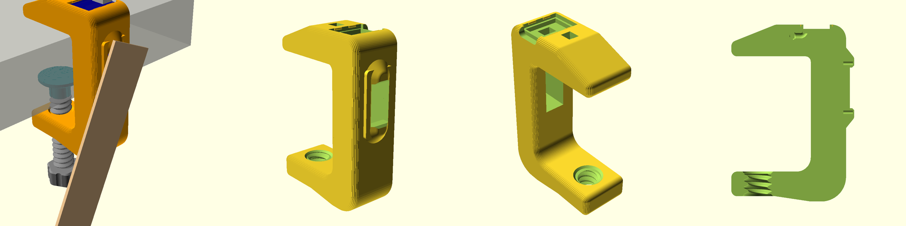
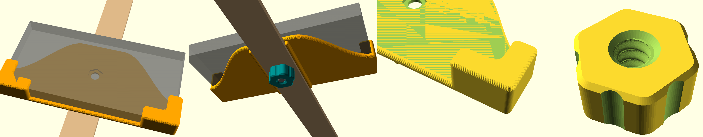

# Step Pendulum — маятник для шагов

Простое и дешёвое устройство, которое качает телефон как маятник, и шагомер телефона
(Google Fit, Health Connect и т.п.) засчитывает эти колебания как шаги.
Цель проекта — повторяемая конструкция с себестоимостью около **$5**.

| Струбцина с сервоприводом | Кроватка для телефона |
|---|---|
|  |  |

## Как это работает

- Струбцина крепится на край стола (толщина столешницы до 50 мм).
- В струбцине вертикально стоит сервопривод SG90, его вал смотрит наружу.
- Стержень маятника — деревянная линейка 30×5 мм с отверстием Ø6, надетая прямо на ступицу качалки сервопривода.
- На линейке закреплена напечатанная «кроватка», телефон лежит в ней горизонтально.
  Кроватка фиксируется пластиковым винтом с ручкой, сдвигая её по линейке можно менять длину маятника.
- Сервопривод раскачивает маятник по синусоиде с заданной частотой: плавный разгон, работа, плавное затухание.
  Каждый период качания засчитывается как 1 или 2 шага.

## Компоненты

| Деталь | Кол-во | Примечание |
|---|---|---|
| ESP32-C3 SuperMini | 1 | контроллер, питание и прошивка через USB-C |
| Сервопривод SG90 | 1 | с комплектными винтами и качалкой |
| Тактовая кнопка 6×6 мм | 1 | встраивается в верхнюю губку струбцины |
| Деревянная линейка 30×5 мм | 1 | стержень маятника, отверстие Ø6 под ступицу серво |
| Провода | — | серво и кнопка к плате |
| Блок питания USB 5 В | 1 | любой телефонный |
| Напечатанные детали | — | см. ниже |

## Подключение

| ESP32-C3 SuperMini | Куда |
|---|---|
| GPIO4 | сигнал сервопривода (оранжевый/жёлтый провод) |
| 5V | питание сервопривода (красный) |
| GND | земля сервопривода (коричневый) |
| GPIO5 | кнопка, второй вывод кнопки на GND |
| GPIO8 | встроенный светодиод платы (ничего подключать не нужно) |

Распиновка платы: [Schematic/esp32-c3-super-mini-pinouts.jpg](Schematic/esp32-c3-super-mini-pinouts.jpg)

## 3D-печать

Модели сделаны в OpenSCAD, исходники параметрические: размеры можно поменять под свою столешницу и телефон.

**Струбцина** — `3D/Clamp/`
- `body_v4.stl` — корпус (гнездо под SG90, посадочное место под плату, углубление под кнопку, канал для проводов)
- `screw.stl` — прижимной винт
- `pad.stl` — пятка винта
- `pendulum_clamp_v4.scad` — исходник

**Кроватка для телефона** — `3D/Cradle/`
- `cradle.stl` — кроватка (под телефон до 165×80×14 мм)
- `bolt.stl` — болт с резьбой Ø8, шаг 3 мм
- `knob.stl` — гайка-ручка
- `pendulum_cradle.scad` — исходник

Чтобы получить STL с другими размерами, откройте `.scad` в OpenSCAD, поменяйте параметры в начале файла
(например `phone_l`, `phone_w`, `phone_t` или `table_max`), выберите деталь в переменной `part` и экспортируйте STL.

## Прошивка

Прошивка на [ESPHome](https://esphome.io): `Firmware/ESP32C3/step-pendulum-c3-retail.yaml`.

1. Скопируйте `secrets.example.yaml` в `secrets.yaml` и задайте свой `ota_password`.
2. Подключите плату по USB-C и прошейте:
   ```
   esphome run step-pendulum-c3-retail.yaml
   ```
   или через ESPHome Dashboard в Home Assistant.

### Первое включение и Wi-Fi

Пароль от домашнего Wi-Fi в прошивку не вшивается.

1. При первом включении устройство поднимает точку доступа `step-pendulum-xxxxxx`
   (пароль по умолчанию `pendulum2026`, задаётся в `ap_password`).
2. Подключитесь к ней с телефона, откроется страница настройки, введите свою сеть Wi-Fi.
3. Если домашняя сеть пропадёт больше чем на 30 секунд, точка доступа включится снова.

Пока устройство не подключено к домашней сети, светодиод коротко мигает раз в 1,5 секунды.

**Сброс к заводским настройкам:** 5 раз подряд выключить и включить питание (каждый раз в течение 10 секунд).

### Управление

**Кнопка на струбцине**
- 1 нажатие = 100 шагов. Несколько нажатий подряд суммируются: после паузы 3 с маятник отработает 100 × N шагов.
- Удержание 3 с — «догнать до дневной цели»: устройство берёт текущее число шагов из Home Assistant
  и докачивает до 5000 (+100 запаса). Нужен Home Assistant, см. ниже.
- Нажатие во время работы — плавная остановка.

Каждое нажатие подтверждается вспышкой светодиода; три быстрые вспышки означают ошибку
(например, нет данных о дневных шагах).

**Веб-интерфейс** — откройте IP-адрес устройства в браузере. Работает без интернета и без Home Assistant.
- Управление: целевое число шагов (Target steps), Start, Stop (smooth) — плавный стоп, Stop now — немедленный стоп
- Состояние: сделано шагов, цель, идёт ли работа, включён ли сервопривод
- Настройки маятника: частота качания (0,3–2,5 Гц), амплитуда сервопривода, время разгона и затухания,
  шагов за период (1 или 2), подстройка центра сервопривода
- Сервис: перезагрузка, сброс, IP, сеть Wi-Fi, уровень сигнала, версия прошивки

**Home Assistant** — устройство находится автоматически через интеграцию ESPHome,
все те же кнопки и настройки появляются как сущности.

### Настройки в начале YAML-файла

| Параметр | По умолчанию | Назначение |
|---|---|---|
| `press_gap` | 3s | пауза после последнего нажатия перед стартом |
| `long_press` | 3s | время удержания для режима «догнать до цели» |
| `steps_per_press` | 100 | шагов за одно нажатие |
| `daily_goal` | 5000 | дневная цель шагов |
| `daily_margin` | 100 | запас сверх цели |
| `ap_password` | pendulum2026 | пароль точки доступа |
| `idle_detach` | 10s | через сколько после остановки отключать сигнал сервопривода |

Для режима «догнать до цели» укажите в секции `sensor` → `platform: homeassistant` сенсор дневных шагов
вашего телефона из приложения Home Assistant Companion (параметр `entity_id`).

### Настройка маятника

1. Подберите длину маятника (положение кроватки на линейке) и частоту так, чтобы маятник
   раскачивался в резонанс с небольшой амплитудой сервопривода.
2. Если шагомер считает вдвое меньше или вдвое больше шагов, поменяйте Steps per swing period (1 или 2).
3. Servo center trim выравнивает маятник вертикально в покое.

## Лицензия

[MIT](LICENSE)
